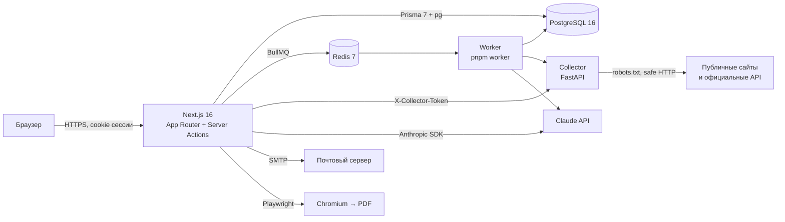

# Архитектура LeadFlow AI

## Обзор



| Компонент | Назначение |
|---|---|
| `apps/web` | UI, server actions, REST-маршруты (`/api/*`), бизнес-сервисы, AI, фоновые задания |
| `apps/collector` | Сбор данных из разрешённых источников. Отдельный сервис: Python-экосистема для парсинга, изоляция сетевых запросов к внешним сайтам от основного приложения |
| `packages/shared` | Код, общий для клиента и сервера: Zod-схемы, справочники с русскими подписями, нормализация, дедупликация, CSV-защита, синтаксическая SSRF-проверка |
| PostgreSQL | Единственный источник истины. Вся аналитика считается запросами к БД |
| Redis + BullMQ | Очередь заданий. Без Redis (или без запущенного worker) задания выполняются в процессе веб-сервера |

## Слои веб-приложения

```
src/app/(app)/**/page.tsx      серверные страницы: загрузка данных через сервисы
src/features/<домен>/*.tsx     клиентские компоненты (формы, таблицы, Kanban)
src/features/<домен>/actions.ts  server actions: requireContext → сервис → audit → revalidatePath
src/server/services/*          бизнес-логика, всегда с ctx.organizationId
src/server/domain/*            чистые функции (эвристика скоринга, шаблон КП) — без БД, покрыты unit-тестами
src/server/ai/*                клиент Claude: структурированные ответы, бюджет, учёт расходов
src/server/jobs/*              очередь, обработчики, worker
src/components/ui|shell|common дизайн-система и оболочка (sidebar, topbar, поиск ⌘K, уведомления)
```

Серверные модули помечены `import "server-only"`; worker запускается с `--conditions=react-server`.

## Ключевые потоки

**Поиск → база.** Пользователь выбирает адаптер и параметры → `DiscoveryJob` + фоновое задание `DISCOVERY` →
адаптер (DEMO в веб-приложении или collector) → кандидаты сохраняются в `DiscoveryJob.results` с пометками дублей →
пользователь выбирает кандидатов → компании и `LeadEvidence` (факты со ссылками на источник).

**Импорт.** Файл парсится на сервере (papaparse / exceljs) → предпросмотр и сопоставление → `ImportJob` + задание
`IMPORT` → дедупликация в файле и против базы → компании, теги, история, уведомление.

**Скоринг.** `scoreCompany()` собирает данные карточки → хэш входа (кэш) → Claude (`LeadScoreResultSchema`) или
эвристика DEMO → нормализация (сумма баллов = итог) → `LeadScore` + `Company.aiScore` + активность.

**КП.** Услуги и цены из каталога → Claude (`ProposalGenerationSchema`) или шаблон → `ProposalVersion` (JSON) →
HTML (`renderProposalHtml`, всё экранируется) → превью в sandbox-iframe / PDF через Chromium с заблокированной сетью.

**Коммуникации.** `MessageDraft` (DRAFT → PENDING_REVIEW → APPROVED) → `checkCompliance()` (получатель, suppression,
основание, опубликованность контакта, повторы, дневной лимит) → `sendDraft()` с явным подтверждением →
`Message` с уникальным ключом идемпотентности `draft:<id>` → SMTP / симуляция / ручная отправка →
ответ (`recordReply`) создаёт задачу, отказ (`optOut`) пополняет suppression list.

## Отличия от исходной структуры ТЗ

- Prisma Client генерируется в `apps/web/src/generated/prisma` (Prisma 7 требует явный output); схема и миграции —
  в корневом `prisma/`, как в ТЗ.
- Логика seed находится в `apps/web/src/server/seed/index.ts`, чтобы использовать те же доменные функции;
  `prisma/seed.ts` — точка входа.
- Импорт CSV/XLSX выполняется в TypeScript (papaparse, exceljs), а не в pandas: базовый сценарий не зависит от
  Python-сервиса, а валидация и дедупликация используют общий код `packages/shared`. Collector отвечает за сетевой сбор.
- Вместо отдельных `MessageDraft`/`Message` статусов в одной таблице: черновик хранит жизненный цикл согласования,
  `Message` — фактические исходящие и входящие сообщения.
- Добавлены модели `BackgroundJob`, `AiUsage`, `Notification` (журнал заданий, расходы на AI, уведомления),
  `Session`/`Account`/`Verification` (Better Auth).
